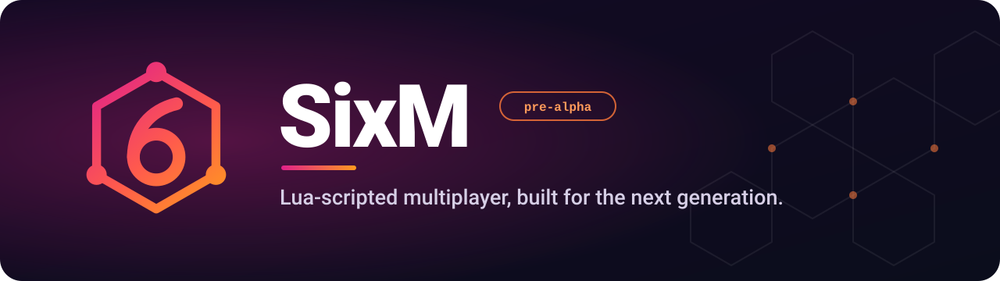
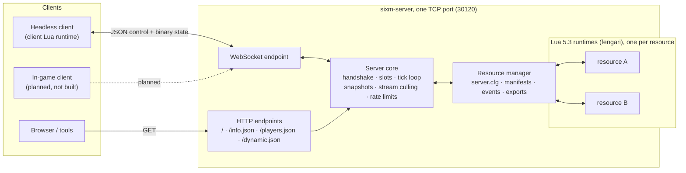

<p align="center">
  
</p>

<h1 align="center">SixM: GTA VI multiplayer framework</h1>

<p align="center">
  <b>An open-source multiplayer framework for GTA VI (GTA 6): a dedicated server, a Lua resource system and a client,
  with gameplay written as scripts.</b><br>
  What FiveM is to GTA V, SixM aims to be for GTA VI. In development: there is no in-game client yet.
</p>

<p align="center">
  <a href="https://github.com/CodingRule/SixM/actions/workflows/ci.yml"></a>
  
  <a href="LICENSE"></a>
  
  
  
</p>

<p align="center">
  <a href="#quick-start">Quick start</a> ·
  <a href="#your-first-resource">First resource</a> ·
  <a href="docs/scripting.md">Lua API</a> ·
  <a href="#architecture">Architecture</a> ·
  <a href="#roadmap">Roadmap</a> ·
  <a href="#help-wanted">Help wanted</a> ·
  <a href="#faq">FAQ</a> ·
  <a href="#legal">Legal</a>
</p>

> [!IMPORTANT]
> **SixM is pre-alpha (v0.1.0) and there is no in-game client yet.**
>
> - SixM does **not** launch, modify or contain GTA VI. You cannot play GTA VI multiplayer with it today.
> - What exists is the dedicated server, the Lua resource system, and a **headless client** (no graphics) used for
>   testing and bots.
> - The planned game integration targets the open-source Leonida runtime
>   ([Leonida Continued](https://github.com/ubiquitarianism/leonida)), which boots the game's menus from your own copy
>   but has nothing playable yet. In-game multiplayer is blocked on that. It is a roadmap item, not a feature.
> - **Own the Xbox Series copy of the game? [You can help.](#help-wanted)**
> - No game files, keys or assets are in this repository, and none ever will be.

## What works today

| | Area | Notes |
|:-:|---|---|
| ✅ | Dedicated server | Handshake, player slots, tick loop (20 Hz by default), heartbeat, rate limiting |
| ✅ | State sync | Position/state snapshots with distance-based stream culling |
| ✅ | HTTP endpoints | `/info.json`, `/players.json`, `/dynamic.json` and a status page at `/`, on the game port |
| ✅ | Configuration | `server.cfg` with `ensure`, convars and endpoint settings |
| ✅ | Resource system | Server-side and client-side Lua scripts, declared in a `manifest.lua` |
| ✅ | Scripting | Threads, local and net events (both directions), commands, exports, convars, JSON |
| ✅ | Headless client | Connects, runs client Lua, can simulate movement. For tests and bots |
| ✅ | Standalone executables | `sixm-server.exe` and `sixm-client.exe` for Windows via `npm run build:exe` |
| 🚧 | In-game client | Planned on top of the Leonida runtime. Blocked upstream: that runtime has no playable game world yet |
| ❌ | Game-world natives | No peds, vehicles, weapons or world natives. There is no game attached to script against |
| ❌ | UDP transport | Transport is WebSocket over TCP for now |
| ❌ | Entity ownership, vehicles, state bags | Only player state is synced |
| ❌ | Server-authoritative validation | Client-reported state is sanity-checked, not validated against game rules |
| ❌ | UI layer, permissions, hot-reload | See the [roadmap](#roadmap) |

## Quick start

You need [Node.js](https://nodejs.org) 22 or newer.

```powershell
git clone https://github.com/CodingRule/SixM
```

```powershell
cd SixM
```

```powershell
npm install
```

Start the server. It listens on port `30120` (TCP) for both HTTP and WebSocket traffic:

```powershell
npm start
```

In a second terminal, connect a headless client:

```powershell
npm run client -- --name Alice
```

Open <http://localhost:30120/> for the status page, or <http://localhost:30120/players.json> to see Alice in the
player list.

Headless client flags:

| Flag | Meaning |
|---|---|
| `--host <host>` | Server host to connect to |
| `--port <port>` | Server port |
| `--name <name>` | Player name |
| `--pos <x,y,z>` | Starting position |
| `--wander` | Walk around randomly, so there is movement to sync |
| `--secure` | Connect with TLS, for servers behind a TLS reverse proxy |

Both the server and the client read commands from their terminal. In the server console try `help`, `status`,
`players` or `say hello`; in the client try `say hello`, `hello`, `near`, `/pos 10 20 0` or `/list`. Those come from
the three resources that ship in `resources/`: `chat`, `welcome` and `hello`.

Run the tests:

```powershell
npm test
```

Build the standalone Windows executables (`sixm-server.exe`, `sixm-client.exe`, packaged with Node SEA):

```powershell
npm run build:exe
```

The result is in `dist/`: the two executables next to a copy of `server.cfg` and `resources/`. They run without
Node.js installed. They are not code-signed, so Windows SmartScreen may warn the first time.

## Your first resource

A resource is a folder under `resources/` with a `manifest.lua` and some scripts.

```
resources/
  greeter/
    manifest.lua
    server.lua
    client.lua
```

**`resources/greeter/manifest.lua`**

```lua
name 'greeter'
description 'Greets players'
author 'you'
version '1.0.0'

server_script 'server.lua'
client_script 'client.lua'
```

**`resources/greeter/server.lua`**

```lua
-- A client asks to be greeted; answer only that client.
RegisterNetEvent('greeter:greetMe', function()
  local id = source -- the player who sent the event
  print(('greeting player %d'):format(id))
  TriggerClientEvent('greeter:greeting', id, 'Welcome, ' .. GetPlayerName(id) .. '!')
end)

-- greet <message...>, typed in the server console or by a connected client, sends a message to every connected client.
RegisterCommand('greet', function(source, args, raw)
  TriggerClientEvent('greeter:greeting', -1, table.concat(args, ' '))
end, false)

-- Threads can sleep without blocking the server.
Citizen.CreateThread(function()
  while true do
    Citizen.Wait(10000)
    print(('%d player(s) online'):format(GetNumPlayers()))
  end
end)
```

**`resources/greeter/client.lua`**

```lua
RegisterNetEvent('greeter:greeting', function(message)
  print(message)
end)

Citizen.CreateThread(function()
  Citizen.Wait(1000)
  TriggerServerEvent('greeter:greetMe')
end)
```

Enable it in `server.cfg`:

```cfg
ensure greeter
```

Restart the server and connect a headless client (the client prefixes script output with the resource name). The client sends `greeter:greetMe`, the server replies with
`greeter:greeting`, and the client prints the greeting. That is a full net event round trip.

Next: the [Lua API reference](docs/scripting.md) and the [resource and manifest reference](docs/resources.md).

## Architecture



- **One port.** HTTP and WebSocket share TCP port `30120`.
- **Two kinds of frames.** JSON text frames carry control messages and events. Binary frames carry packed entity
  state. The exact layout is in [docs/protocol.md](docs/protocol.md).
- **One Lua runtime per resource.** Scripts run in a sandboxed Lua 5.3 VM (fengari, pure JavaScript). There is no
  `io`, no `os.execute`, and no filesystem or native-code loading from scripts.
- **Client scripts are real.** The headless client runs each resource's client scripts in its own Lua runtime, so
  both halves of a resource can be tested without a game.

More detail in [docs/architecture.md](docs/architecture.md).

## Configuration

The server reads `server.cfg`. A minimal file:

```cfg
sv_hostname "My SixM server"
sv_maxclients 32
endpoint_add_tcp "0.0.0.0:30120"

sets tags "roleplay, dev"
set mykey value

ensure hello
```

| Directive | Purpose |
|---|---|
| `sv_hostname "<name>"` | Server name |
| `sv_maxclients <n>` | Number of player slots |
| `endpoint_add_tcp "<ip>:<port>"` | Address and port to listen on (HTTP and WebSocket) |
| `ensure <resource>` | Start a resource from `resources/` |
| `set <key> <value>` | Set a convar, readable from Lua with `GetConvar` |
| `sets <key> <value>` | Set a convar that is also published as server info |

Full reference: [docs/configuration.md](docs/configuration.md).

## HTTP endpoints

Served on the same port as the game traffic.

| Path | Returns |
|---|---|
| `/` | Human-readable status page |
| `/info.json` | Server information |
| `/players.json` | Connected players |
| `/dynamic.json` | Values that change while the server runs |

## Coming from FiveM?

SixM borrows the developer experience, not the code. Function names for events and threads are deliberately the
same, so the mental model carries over. The game-facing parts do not exist yet.

| In FiveM | In SixM | Notes |
|---|---|---|
| `fxmanifest.lua` | `manifest.lua` | `name`, `description`, `author`, `version`, `server_script(s)`, `client_script(s)`, `shared_script` |
| `server.cfg`, `ensure` | `server.cfg`, `ensure` | Same idea. See [docs/configuration.md](docs/configuration.md) for what is supported |
| `Citizen.CreateThread`, `Citizen.Wait`, `SetTimeout` | Same names | `CreateThread` and `Wait` aliases included |
| `AddEventHandler`, `RegisterNetEvent`, `TriggerEvent` | Same names | |
| `TriggerClientEvent`, `TriggerServerEvent`, `source` | Same names | Target `-1` means everyone |
| `RegisterCommand`, `exports`, convars | Same names | |
| `GetPlayers`, `GetPlayerName`, `DropPlayer`, ... | Same names | A small subset. See [docs/scripting.md](docs/scripting.md) |
| Game natives (peds, vehicles, world) | **Not available** | No game is attached. Only player position, heading and basic state are synced |
| NUI (HTML UI) | **Not available** | |
| OneSync | **No equivalent** | Only basic distance-based stream culling of player state |
| State bags | **Not available** | On the roadmap |
| ACL / `add_ace` | **Not available** | On the roadmap |
| Lua 5.4, JavaScript, C# runtimes | **Lua 5.3 only** | Runs on fengari, a Lua 5.3 VM in JavaScript |
| UDP (ENet) transport | **WebSocket over TCP** | UDP is on the roadmap |

Existing FiveM resources will not run unmodified: anything that calls game natives, NUI or a framework that depends
on them has nothing to call into.

## Roadmap

- [x] Dedicated server, resource system, net events, headless client
- [ ] In-game client through a Leonida runtime hook (**blocked upstream**: no playable game world yet). See [docs/game-integration.md](docs/game-integration.md)
- [ ] UDP transport
- [ ] Entity ownership and vehicles
- [ ] Server-authoritative validation
- [ ] State bags
- [ ] Additional script runtimes (JavaScript, C#)? Undecided
- [ ] Resource hot-reload
- [ ] ACL / permissions
- [ ] Web admin panel

No dates. Items land when they work.

## Help wanted

SixM needs two kinds of people.

**Anyone who writes code.** Networking, scripting and hosting work needs no game at all. Start with the issues
labelled [`good first issue`](https://github.com/CodingRule/SixM/issues?q=is%3Aissue+is%3Aopen+label%3A%22good+first+issue%22)
or [`help wanted`](https://github.com/CodingRule/SixM/issues?q=is%3Aissue+is%3Aopen+label%3A%22help+wanted%22).

**Anyone who owns the Xbox Series copy of GTA VI.** The in-game client cannot be built without people who can run
the game through Leonida and report what happens. See the issues labelled
[`needs-game-copy`](https://github.com/CodingRule/SixM/issues?q=is%3Aissue+is%3Aopen+label%3Aneeds-game-copy) and
read [docs/game-integration.md](docs/game-integration.md) first. Never post game files, keys or instructions for
obtaining them.

## FAQ

### Can I play GTA 6 multiplayer with SixM today?

No. SixM has a working server and a text-only test client, but no client inside the game. Nobody can play GTA VI
multiplayer through SixM yet.

### Is SixM "FiveM for GTA 6"?

That is the goal: custom multiplayer servers for GTA VI with gameplay written in Lua, the way FiveM does it for
GTA V. SixM is a separate project with its own code. It is not made by, or affiliated with, Cfx.re or Rockstar Games.

### When will GTA 6 multiplayer mods work?

There is no date. It depends on GTA VI running on PC with a playable world. Today the only route is the community
project Leonida, which boots the game's menus from your own Xbox Series copy and is not playable yet.

### Is there a GTA 6 roleplay (RP) server I can join?

Not on SixM. You can host a SixM server now and write the Lua resources for one, but players can only connect with
the headless client.

### Do I need to own GTA VI?

Not to run the server, write resources or contribute to the networking and scripting code. Any future in-game client
will require your own copy of the game. SixM will never ship game files.

### Will my FiveM resources work?

Not unmodified. The event, thread and command functions have the same names, so plain Lua logic ports easily.
Anything that calls game natives, NUI or a framework built on them has nothing to call yet.

### How do I host a SixM server?

Download the [latest release](https://github.com/CodingRule/SixM/releases), run `sixm-server.exe`, and read
[docs/hosting.md](docs/hosting.md).

## Project layout

```
SixM/
  bin/                  entry points: sixm-server.js, sixm-client.js
  src/
    server/             dedicated server
    client/             headless client
    shared/
      protocol.js       wire protocol, shared by server and client
      lua/              Lua runtime integration
  resources/            resources, one folder each; [brackets] are category folders
  scripts/              build tooling (build-exe.mjs)
  test/                 tests, run with `npm test`
  docs/                 documentation
  assets/               logo and banner
  server.cfg            server configuration
```

## Documentation

- [Lua scripting API](docs/scripting.md)
- [Resources and manifests](docs/resources.md)
- [Configuration (`server.cfg`)](docs/configuration.md)
- [Hosting a server](docs/hosting.md)
- [GTA VI integration: status and how to help](docs/game-integration.md)
- [Wire protocol](docs/protocol.md)
- [Architecture](docs/architecture.md)

## Contributing

Contributions are welcome. Read [CONTRIBUTING.md](CONTRIBUTING.md) first, and the
[Code of Conduct](CODE_OF_CONDUCT.md). Report security issues privately as described in [SECURITY.md](SECURITY.md).

## Legal

SixM is an independent, community project. It is **not affiliated with, endorsed by, or connected to Rockstar Games,
Take-Two Interactive, or Cfx.re / FiveM**.

- All code in this repository is original. It is inspired by the developer experience of FiveM and is not derived
  from Cfx.re or FiveM source code.
- Grand Theft Auto, GTA, Rockstar Games, Take-Two, FiveM and all related names and marks are trademarks of their
  respective owners. They are used here only to describe what this project is and is not.
- This repository contains no game code, game files, keys or assets, and contributions that include any will be
  rejected.
- SixM does not launch or modify any game today. Any future game integration will require you to own a legitimate
  copy of the game.

## License

[MIT](LICENSE) © 2026 SixM contributors
