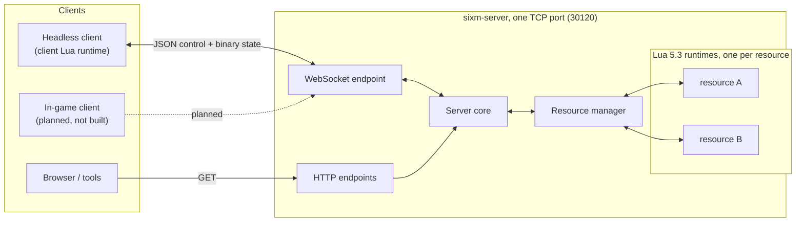

# Architecture

SixM has two programs and one shared protocol.



## Pieces

**Server core.** Accepts WebSocket connections, runs the handshake, assigns player slots and runs the tick loop
(20 Hz by default). On each tick it sends every client a snapshot of the players near it; players out of range are
culled. It also applies rate limiting and tracks heartbeats.

**HTTP endpoints.** The same port answers plain HTTP: a status page at `/`, plus `/info.json`, `/players.json` and
`/dynamic.json`.

**Resource manager.** Reads `server.cfg`, loads each `ensure`d resource's `manifest.lua`, and routes events,
commands and exports between resources and the network.

**Lua runtimes.** Each resource runs in its own Lua 5.3 VM. The VM is [fengari](https://fengari.io), which is written
in JavaScript, so there is no native code to compile. Scripts are sandboxed: no `io`, no `os.execute`, no filesystem
access and no native-code loading.

**Headless client.** A client with no graphics. It connects, runs the client scripts of the server's resources in
its own Lua runtimes, and can simulate movement. It exists for tests and bots, and it lets both halves of a resource
be developed without a game.

**Shared protocol.** `src/shared/protocol.js` defines the message types and binary layouts used by both sides. See
[protocol.md](protocol.md).

## Technology

| | |
|---|---|
| Runtime | Node.js 22 or newer, ES modules |
| Networking | `ws` WebSockets over TCP, HTTP on the same port |
| Scripting | `fengari`, a Lua 5.3 VM in JavaScript |
| Packaging | Source, or standalone Windows executables built with Node SEA (`npm run build:exe`) |

## Source layout

```
bin/                  entry points: sixm-server.js, sixm-client.js
src/server/           dedicated server
src/client/           headless client
src/shared/protocol.js  wire protocol
src/shared/lua/       Lua runtime integration
scripts/              build tooling
test/                 tests
```

## What is not here

There is no in-game client. The plan is to hook the open-source Leonida recompilation runtime, and that runtime does
not boot the game yet, so this work is blocked upstream. Until then SixM has no rendering, no game world and no game
natives. See the roadmap in the [README](../README.md#roadmap).
