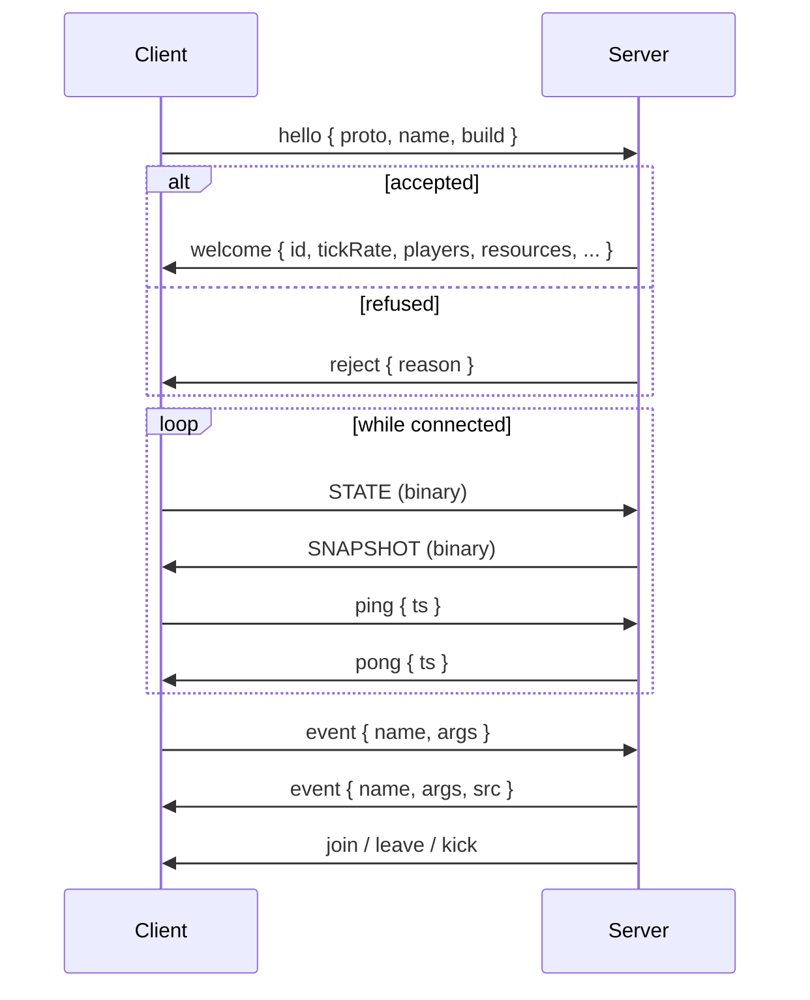

# Wire protocol

This document describes protocol version **1**, as implemented in
[`src/shared/protocol.js`](../src/shared/protocol.js). That file is the source of truth; if the two disagree, the
code wins and this page has a bug.

> [!WARNING]
> SixM is pre-alpha. The protocol is not stable and will change without a compatibility period.

## Transport

- One WebSocket connection per player.
- Default port **30120** (TCP). The same port serves the HTTP endpoints.
- **Text frames** carry JSON control messages.
- **Binary frames** carry entity state. They are sent many times per second, so they are packed tightly.
- All multi-byte binary fields are **little-endian**.

## Limits

| Constant | Value | Meaning |
|---|---|---|
| `PROTOCOL_VERSION` | `1` | Sent by the client in `hello` |
| `DEFAULT_PORT` | `30120` | |
| `MAX_NAME_LENGTH` | `32` | Player names are truncated to this many characters |
| `MAX_EVENT_NAME_LENGTH` | `128` | Maximum event name length |
| `MAX_JSON_FRAME` | `262144` (256 × 1024) | A JSON frame longer than this many characters is rejected |

## JSON control messages

Every control message is a JSON object with a string field `t` holding the message type. A frame that is not valid
JSON, is not an object, has no string `t`, or exceeds `MAX_JSON_FRAME` is not a valid control message.

```json
{ "t": "hello", "proto": 1, "name": "Alice", "build": "..." }
```

### Client → server

| `t` | Fields | Purpose |
|---|---|---|
| `hello` | `proto`, `name`, `build`, `token` (optional) | First message. Announces the protocol version and player name |
| `event` | `name`, `args` | Trigger a net event on the server |
| `ping` | `ts` | Heartbeat / latency probe |

### Server → client

| `t` | Fields | Purpose |
|---|---|---|
| `welcome` | `id`, `serverName`, `tickRate`, `maxPlayers`, `players` (`[{ id, name }]`), `resources` (`[...]`) | Handshake accepted. `id` is the player's id |
| `reject` | `reason` | Handshake refused |
| `join` | `id`, `name` | Another player joined |
| `leave` | `id`, `reason` | A player left |
| `pong` | `ts` | Reply to `ping`, echoing `ts` |
| `kick` | `reason` | The player is being removed |
| `event` | `name`, `args`, `src` | Trigger a net event on the client |

### Player names

Names supplied by clients are sanitised: control characters (`U+0000`–`U+001F` and `U+007F`) are removed, the result
is trimmed, then cut to `MAX_NAME_LENGTH` characters. A name can be empty after sanitising.

## Binary frames

The first byte of a binary frame is its type.

| Type byte | Name | Direction | Content |
|---|---|---|---|
| `1` | `STATE` | client → server | The sending player's own state |
| `2` | `SNAPSHOT` | server → client | States of the entities relevant to that client |

### EntityState (34 bytes)

Both frame types embed this structure. Offsets are relative to the start of the structure.

| Offset | Size | Type | Field | Notes |
|---:|---:|---|---|---|
| 0 | 4 | float32 | `x` | |
| 4 | 4 | float32 | `y` | |
| 8 | 4 | float32 | `z` | |
| 12 | 4 | float32 | `heading` | Degrees |
| 16 | 4 | float32 | `vx` | Velocity |
| 20 | 4 | float32 | `vy` | |
| 24 | 4 | float32 | `vz` | |
| 28 | 4 | uint32 | `model` | Model hash |
| 32 | 2 | uint16 | `flags` | `StateFlags` bitmask |

### StateFlags

| Bit | Value | Flag |
|---:|---:|---|
| 0 | `0x0001` | `IN_VEHICLE` |
| 1 | `0x0002` | `AIMING` |
| 2 | `0x0004` | `SHOOTING` |
| 3 | `0x0008` | `DEAD` |
| 4 | `0x0010` | `SPRINTING` |

Bits 5–15 are unused.

These flags are fields in the wire format. Nothing in SixM drives a game from them yet.

### STATE frame (client → server), 39 bytes

| Offset | Size | Type | Field | Notes |
|---:|---:|---|---|---|
| 0 | 1 | uint8 | type | Always `1` |
| 1 | 4 | uint32 | `seq` | Sequence number chosen by the client |
| 5 | 4 | float32 | `x` | |
| 9 | 4 | float32 | `y` | |
| 13 | 4 | float32 | `z` | |
| 17 | 4 | float32 | `heading` | |
| 21 | 4 | float32 | `vx` | |
| 25 | 4 | float32 | `vy` | |
| 29 | 4 | float32 | `vz` | |
| 33 | 4 | uint32 | `model` | |
| 37 | 2 | uint16 | `flags` | |

The decoder returns nothing (the frame is treated as malformed) when:

- the frame is not exactly 39 bytes,
- the type byte is not `1`, or
- any of the seven floats is not finite (NaN or ±Infinity).

### SNAPSHOT frame (server → client), 7 + 36 × N bytes

Header:

| Offset | Size | Type | Field | Notes |
|---:|---:|---|---|---|
| 0 | 1 | uint8 | type | Always `2` |
| 1 | 4 | uint32 | `tick` | Server tick the snapshot was taken on |
| 5 | 2 | uint16 | `count` | Number of entries, N |

Followed by N entries of 36 bytes. Entry `i` starts at offset `7 + 36 × i`:

| Offset in entry | Size | Type | Field |
|---:|---:|---|---|
| 0 | 2 | uint16 | `id` (entity id) |
| 2 | 34 | EntityState | state |

A snapshot is malformed when it is shorter than 7 bytes, the type byte is not `2`, or its length is not exactly
`7 + 36 × count`.

A snapshot holds only the entities relevant to the receiving client: the server culls by distance, so far-away
players are left out.

### Worked example

A snapshot with one entity is `7 + 36 = 43` bytes:

```
02              type = SNAPSHOT
2A 00 00 00     tick = 42
01 00           count = 1
03 00           id = 3
00 00 C8 42     x = 100.0
00 00 48 43     y = 200.0
00 00 F0 41     z = 30.0
00 00 B4 42     heading = 90.0
00 00 00 00     vx = 0
00 00 00 00     vy = 0
00 00 00 00     vz = 0
00 00 00 00     model = 0
10 00           flags = SPRINTING
```

## Typical session



The rates and ordering in the loop are decided by the server and client implementations, not by the wire format.
