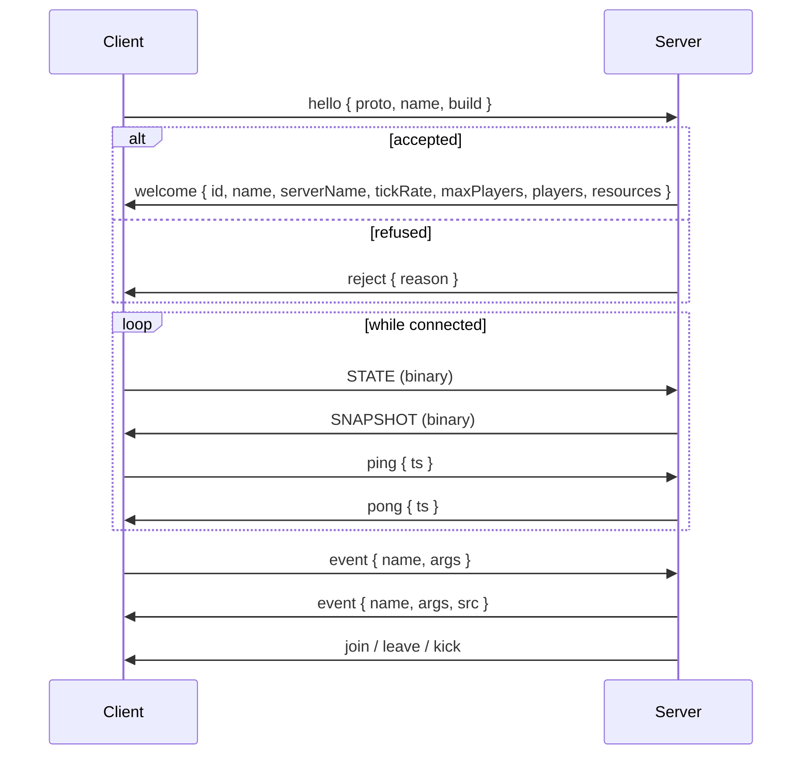

# Wire protocol

This document describes protocol version **1**, as implemented in
[`crates/sixm-protocol/src/lib.rs`](../crates/sixm-protocol/src/lib.rs). That file is the source of truth; if the two
disagree, the code wins and this page has a bug. The server-side rules (timeouts, rate limits, close codes) are in
[`crates/sixm-server/src/core.rs`](../crates/sixm-server/src/core.rs).

The protocol did not change when SixM moved from Node.js to Rust in 0.2: a 0.1 client can join a 0.2 server.

> [!WARNING]
> SixM is pre-alpha. The protocol is not stable and will change without a compatibility period.

## Transport

- One WebSocket connection per player, opened with an HTTP upgrade request for `/` or `/ws`.
- Default port **30120** (TCP). The same port serves the HTTP endpoints.
- **Text frames** carry JSON control messages.
- **Binary frames** carry entity state. They are sent many times per second, so they are packed tightly.
- All multi-byte binary fields are **little-endian**.
- No TLS in the server itself. A client connects with `wss://` only when a TLS reverse proxy sits in front.

## Limits

| Constant | Value | Meaning |
|---|---|---|
| `PROTOCOL_VERSION` | `1` | Sent by the client in `hello` |
| `DEFAULT_PORT` | `30120` | |
| `MAX_NAME_LENGTH` | `32` | Player names are cut to this many characters |
| `MAX_EVENT_NAME_LENGTH` | `128` | Maximum event name length, in UTF-16 code units. An empty name is invalid too |
| `MAX_JSON_FRAME` | `262144` (256 × 1024) | A JSON frame longer than this many bytes is not accepted |
| `COMMAND_EVENT` | `__sixm:command` | Reserved event name, see [Commands](#commands) |

The server also applies `MAX_JSON_FRAME` as the maximum size of any WebSocket message it reads. A client that sends
a larger one loses its connection.

## JSON control messages

Every control message is a JSON object with a string field `t` holding the message type. A frame that is not valid
JSON, is not an object, has no string `t`, has an unknown `t`, or exceeds `MAX_JSON_FRAME` is not a valid control
message.

```json
{ "t": "hello", "proto": 1, "name": "Alice", "build": "..." }
```

### Client → server

| `t` | Fields | Purpose |
|---|---|---|
| `hello` | `proto`, `name`, `build` (optional), `token` (optional) | First message. Announces the protocol version and player name |
| `event` | `name`, `args` (array, optional) | Trigger a net event on the server |
| `ping` | `ts` (number) | Latency probe. The server echoes `ts` back |

The server reads at most 64 characters of `build` and 4096 of `token`. `token` is carried through the handshake but
nothing uses it yet.

### Server → client

| `t` | Fields | Purpose |
|---|---|---|
| `welcome` | `id`, `name`, `serverName`, `tickRate`, `maxPlayers`, `players`, `resources` | Handshake accepted |
| `reject` | `reason` | Handshake refused. The connection is closed after it |
| `join` | `id`, `name` | Another player joined |
| `leave` | `id`, `reason` | A player left |
| `pong` | `ts` | Reply to `ping`, echoing `ts` exactly as it was sent |
| `kick` | `reason` | The player is being removed. The connection is closed after it |
| `event` | `name`, `args`, `src` | Trigger a net event on the client. `src` is `0`, meaning the server |

Fields of `welcome`:

| Field | Type | Meaning |
|---|---|---|
| `id` | integer | The player's id. Ids start at 1; a new player gets the lowest free one |
| `name` | string | The player's name as the server accepted it, after sanitising |
| `serverName` | string | The server's name |
| `tickRate` | integer | Snapshots per second |
| `maxPlayers` | integer | Number of player slots |
| `players` | `[{ id, name }]` | Everyone already connected, not including the receiver |
| `resources` | `[{ name, scripts: [{ file, code }] }]` | The client scripts of every started resource that has any, as source text |

### Player names

Names supplied by clients are sanitised: Unicode control characters (`U+0000`–`U+001F` and `U+007F`–`U+009F`) are
removed, the result is trimmed, cut to `MAX_NAME_LENGTH` characters, and trimmed at the end again. The server
refuses a `hello` whose name is empty after sanitising.

### Handshake

1. The client opens the WebSocket and sends `hello` as its first frame. A connection that has not sent it within
   5 seconds is rejected.
2. The server answers `reject` when the first frame is not a `hello`, `proto` is not `1`, the name is empty after
   sanitising, the server is full, or a resource refuses the player in its `playerConnecting` handler. A resource
   may also defer the decision; an unanswered deferral is rejected after 10 seconds.
3. Otherwise the server answers `welcome`, sends `join` to the other players, and starts including the new player in
   snapshots once it has sent its first `STATE` frame.

The server closes a rejected connection with WebSocket close code `4001` and a kicked one with `4002`. A player
dropped for a timeout or for not reading its socket is cut off without a close handshake.

### Events

`event` carries a name and a JSON array of arguments. On the server an event is delivered only to resources that
registered its name with `RegisterNetEvent`, and the same holds on the client.

### Commands

A command line typed in a client that no client script handles is sent to the server as an `event` named
`__sixm:command` with the line as its only argument. The server ignores lines longer than 512 bytes, and runs the
command only if a resource registered it as unrestricted.

### Heartbeat and latency

- The server sends a WebSocket-level ping to every player every 5 seconds and measures the player's ping from the
  pong. A player from whom nothing has arrived for 15 seconds is dropped with the reason `timed out`.
- The JSON `ping` / `pong` pair lets the client measure its own round trip. The reference client sends one every
  2 seconds.

### What the server tolerates

| Behaviour | Consequence |
|---|---|
| More than 50 `event` or `ping` messages per second (bursts of up to 100) | An `event` over the limit gets the player kicked (`event rate limit`). A `ping` over the limit is not answered |
| More `STATE` frames per second than four times the tick rate | The extra frames are dropped silently |
| A malformed frame: invalid JSON, an unknown `t`, a bad event name, `args` that is not an array, a bad `ping`, a bad `STATE` frame | One strike. Five strikes get the player kicked (`too many malformed messages`). One strike is forgiven for every 10 seconds without a new one |
| Not reading from the socket until 16 MB are queued | The player is dropped. Snapshots are already skipped for a client with more than 1 MB queued |

## Binary frames

The first byte of a binary frame is its type.

| Type byte | Name | Direction | Content |
|---|---|---|---|
| `1` | `STATE` | client → server | The sending player's own state |
| `2` | `SNAPSHOT` | server → client | States of the entities relevant to that client |

### EntityState (34 bytes)

Both frame types embed this structure. Offsets are relative to the start of the structure.

| Offset | Size | Type | Field | Notes |
|---:|---:|---|---|---|
| 0 | 4 | float32 | `x` | |
| 4 | 4 | float32 | `y` | |
| 8 | 4 | float32 | `z` | |
| 12 | 4 | float32 | `heading` | Degrees |
| 16 | 4 | float32 | `vx` | Velocity |
| 20 | 4 | float32 | `vy` | |
| 24 | 4 | float32 | `vz` | |
| 28 | 4 | uint32 | `model` | Model hash |
| 32 | 2 | uint16 | `flags` | `StateFlags` bitmask |

### StateFlags

| Bit | Value | Flag |
|---:|---:|---|
| 0 | `0x0001` | `IN_VEHICLE` |
| 1 | `0x0002` | `AIMING` |
| 2 | `0x0004` | `SHOOTING` |
| 3 | `0x0008` | `DEAD` |
| 4 | `0x0010` | `SPRINTING` |

Bits 5–15 are unused.

These flags are fields in the wire format. Nothing in SixM drives a game from them yet.

### STATE frame (client → server), 39 bytes

| Offset | Size | Type | Field | Notes |
|---:|---:|---|---|---|
| 0 | 1 | uint8 | type | Always `1` |
| 1 | 4 | uint32 | `seq` | Sequence number chosen by the client |
| 5 | 4 | float32 | `x` | |
| 9 | 4 | float32 | `y` | |
| 13 | 4 | float32 | `z` | |
| 17 | 4 | float32 | `heading` | |
| 21 | 4 | float32 | `vx` | |
| 25 | 4 | float32 | `vy` | |
| 29 | 4 | float32 | `vz` | |
| 33 | 4 | uint32 | `model` | |
| 37 | 2 | uint16 | `flags` | |

The decoder returns nothing (the frame is treated as malformed) when:

- the frame is not exactly 39 bytes,
- the type byte is not `1`, or
- any of the seven floats is not finite (NaN or ±Infinity).

After a player's first accepted frame, the server ignores a frame whose `seq` is not newer than the last accepted
one. "Newer" is decided with wrap-around arithmetic: less than 2³¹ ahead of the last value, so the counter may wrap
from `0xFFFFFFFF` to `0`.

### SNAPSHOT frame (server → client), 7 + 36 × N bytes

Header:

| Offset | Size | Type | Field | Notes |
|---:|---:|---|---|---|
| 0 | 1 | uint8 | type | Always `2` |
| 1 | 4 | uint32 | `tick` | Server tick the snapshot was taken on (the low 32 bits of the tick counter) |
| 5 | 2 | uint16 | `count` | Number of entries, N |

Followed by N entries of 36 bytes. Entry `i` starts at offset `7 + 36 × i`:

| Offset in entry | Size | Type | Field |
|---:|---:|---|---|
| 0 | 2 | uint16 | `id` (entity id) |
| 2 | 34 | EntityState | state |

A snapshot is malformed when it is shorter than 7 bytes, the type byte is not `2`, or its length is not exactly
`7 + 36 × count`.

A snapshot holds only the entities relevant to the receiving client:

- It never contains the receiver itself.
- It contains only players who have sent at least one `STATE` frame.
- The server culls by distance, so players further away than the stream distance are left out. A receiver that has
  not reported a position yet gets no one while culling is on.
- A player that was in the previous snapshot and is missing from this one has gone out of range (or left); the
  client should stop showing it.
- The server sends nothing on a tick where the snapshot would be empty and the previous one was empty too.

### Worked example

A snapshot with one entity is `7 + 36 = 43` bytes:

```
02              type = SNAPSHOT
2A 00 00 00     tick = 42
01 00           count = 1
03 00           id = 3
00 00 C8 42     x = 100.0
00 00 48 43     y = 200.0
00 00 F0 41     z = 30.0
00 00 B4 42     heading = 90.0
00 00 00 00     vx = 0
00 00 00 00     vy = 0
00 00 00 00     vz = 0
00 00 00 00     model = 0
10 00           flags = SPRINTING
```

## Typical session



The rates and ordering in the loop are decided by the server and client implementations, not by the wire format.
The reference client sends a `STATE` frame at most once per tick, and only when its state changed.
